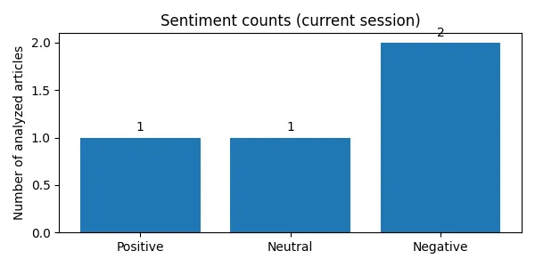

# Finance News AI Analyzer

## Project Overview

For this project, I created a simple AI application that analyzes financial news. The user can enter a financial article, see whether its sentiment is positive, negative, or neutral, get a short AI-generated summary, and ask a question about the article.

I built the project in Google Colab using Python. I also used Gradio to create an interface so users can test the application without writing code.

## Project Features

- **Text preprocessing:** Cleans sample news text by converting it to lowercase and removing URLs, punctuation, and extra spaces.
- **Sentiment analysis:** Uses VADER to label an article as positive, negative, or neutral and show a sentiment score.
- **AI summary:** Uses the Qwen2.5-1.5B-Instruct language model to generate a short summary of the financial article.
- **Question answering:** Uses the same language model to answer a question based on the provided article.
- **User interface:** Uses Gradio to display the article input, question input, sentiment, summary, and answer.
- **Optional extension: Sentiment dashboard:** Shows a bar chart of positive, neutral, and negative results from articles analyzed during the current app session.
- **Optional extension: Named entity recognition (NER):** Uses spaCy to find organizations, people, locations, and dates in articles.
- **Optional extension: LLM financial insights:** Generates a short positive development, risk, and overall takeaway using Qwen.

## Tools and Libraries

- Python and Google Colab
- Pandas for working with the example dataset
- Regular expressions (`re`) for basic text cleaning
- VADER Sentiment for sentiment analysis
- Hugging Face Transformers and PyTorch for the language model
- Qwen2.5-1.5B-Instruct for summaries and question answering
- Gradio for the application interface
- spaCy with `en_core_web_sm` for named entity recognition
- Matplotlib for the sentiment chart

## How to Run the Project

1. Open `AI_Finance_Analyzer_Advanced.ipynb` in Google Colab.
2. For faster LLM responses, choose **Runtime > Change runtime type > T4 GPU**, if available.
3. Select **Runtime > Run all** to install the required libraries, prepare the sample data, load the model, and start the application.
4. Wait for the model to download. The first run may take some time.
5. When the Gradio interface appears, paste a financial article into the text box.
6. Enter a question about the article and click **Analyze Financial News**.
7. Review the sentiment score, generated summary, answer, named entities, and financial insights.
8. Analyze another article to update the session sentiment chart.

The notebook installs its additional libraries using `%pip`. It requires internet access to download the language model. A GPU is recommended but not required.

## Example Test

**Article:**

ABC Technology reported a 20% increase in revenue in the second quarter of 2026. Rising operating costs and supply chain delays may affect future earnings.

**Question:** What financial risks does the company face?

In my test, VADER classified the article as positive. The LLM generated a summary about revenue growth and financial challenges, then answered that rising operating costs and supply chain delays could affect future earnings. The exact generated wording may vary.

*ABC Technology is a fictional example used to test the application.*

## Business Use Case

A financial analyst or news research team could use an application like this to review news articles more quickly. Sentiment analysis gives a quick first impression, while the LLM helps summarize important points and find information in the text. The results are meant to assist a person, not make investment decisions automatically.

## Limitations

- The notebook includes five sample headlines created for demonstration. It does not collect live financial news.
- VADER is rule-based and may not understand complicated financial language or mixed sentiment correctly.
- The sentiment score does not predict stock prices or investment performance.
- The chart counts each analysis during the current app session (including repeated submissions). It does not represent market trends or a live news dataset.
- spaCy NER may miss company names or mislabel entities.
- The LLM can still generate incorrect or unsupported information, so its summaries and answers need to be checked against the original article.
- The application is intended for short articles; very long inputs are rejected.
- The small example dataset is not a labeled dataset for evaluating classifier accuracy, so no measured classification accuracy is claimed.
- The application is for educational purposes and does not provide financial advice. Confidential financial or customer information should not be entered into a public demo.

## What I Learned

This project helped me practice text preprocessing, sentiment analysis, using a pretrained language model, and connecting different Python functions to a simple interface. I also learned that an AI model can produce an answer that sounds correct but includes information that was not in the article, so testing and checking the generated results are important.

## Optional Advanced Extensions

I added an interactive sentiment chart, named entity recognition using spaCy, and an LLM-generated financial insights section. These features are based on the optional advanced extension in the assignment. The dashboard counts articles I test in the session, and the NER model finds names and dates when possible. The insights section highlights positive information and risks from the article. All AI outputs need to be checked because they can still make mistakes.

## Application Screenshots and Test Results

The screenshots below show the articles I tested and the results generated by the application. All example company articles are fictional and used for testing.

### Positive Sentiment Test

This example shows financial growth and its related AI analysis.

### Negative Sentiment Test

This example shows financial losses and operational risks.

### Neutral-Style Article Test

The MetroBank shareholder-meeting article was informational, but VADER classified it as negative. This helped demonstrate a limitation of rule-based sentiment analysis.

### Sentiment Dashboard

After testing four articles, the session dashboard showed one positive, one neutral, and two negative classifications. A separate Horizon Bank report was classified as neutral.

## Open in Google Colab

Click the button above to open the project in Google Colab.

**Note:** The Gradio application does not run directly inside
GitHub. It requires an active Google Colab session.

